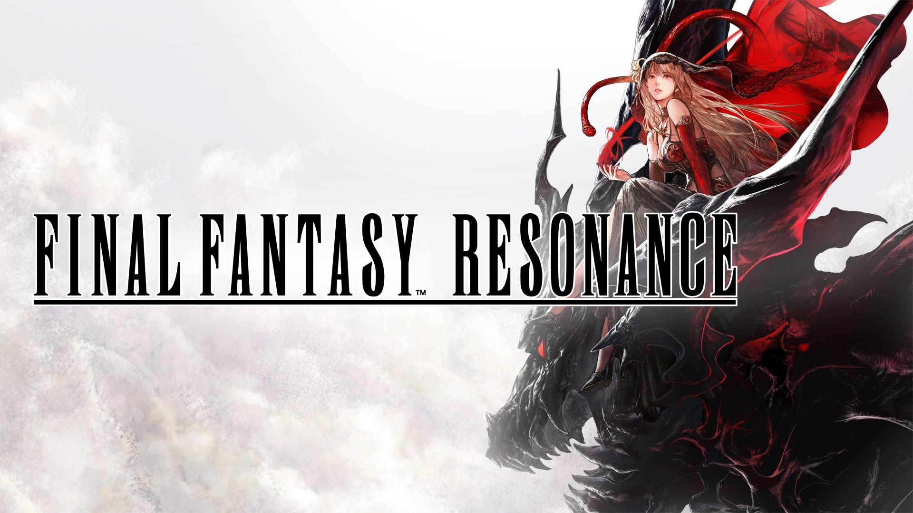
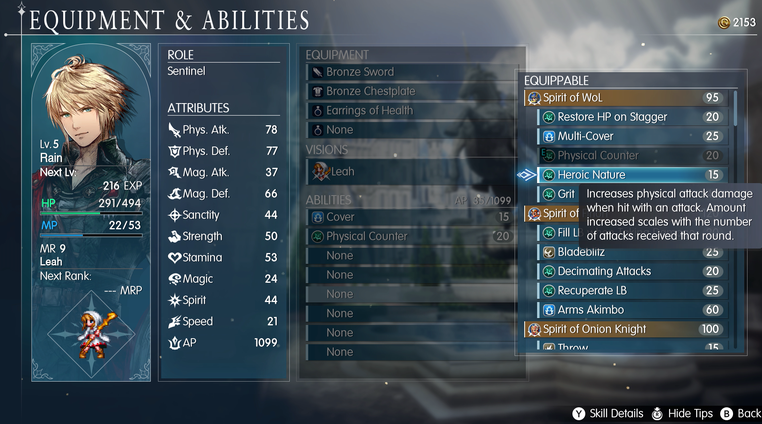
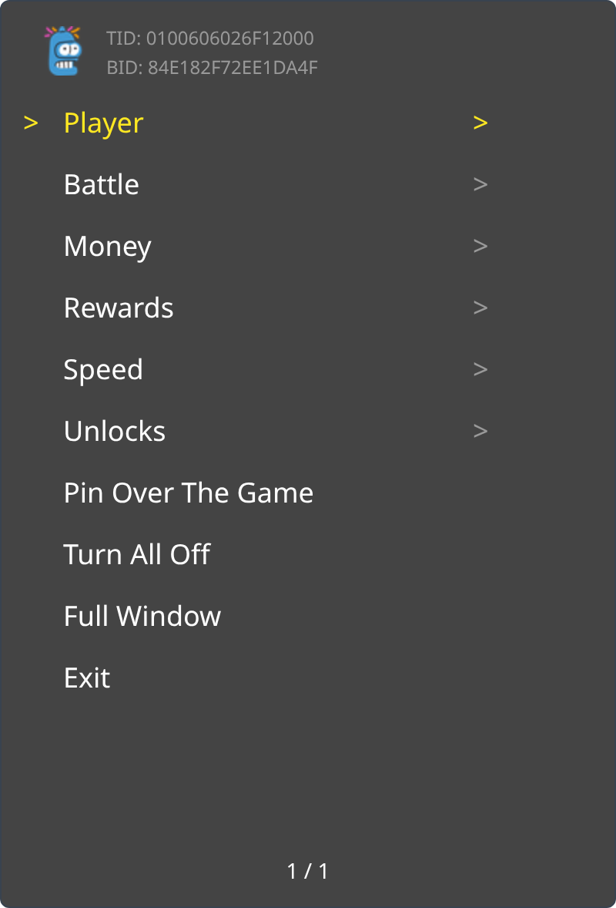
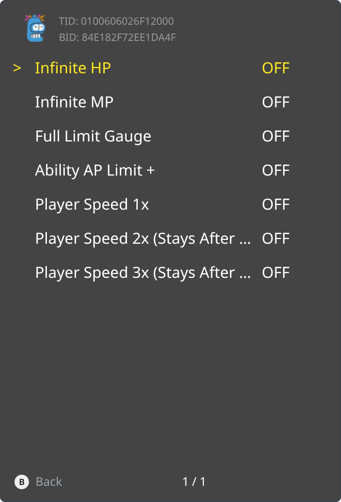
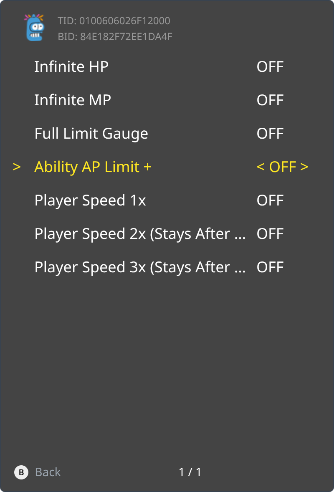

<p align="center">
  
</p>

Hope resonates within the crystals

<p></p>

You can't have all the cheats on, they go over the limit of CheatVM. Use the trainer if you want to use more cheats. Instructions are on GitHub, do not ask here.

<p><a href="_assets/trainer-84E182F72EE1DA4F-main.png"></a> <a href="_assets/trainer-84E182F72EE1DA4F-folder.png"></a> <a href="_assets/trainer-84E182F72EE1DA4F-options.png"></a></p>

```graphql
# FINAL FANTASY RESONANCE (GLOBAL) (v65536)
./khuong/0100606026F12000/84E182F72EE1DA4F/*
  ├─ Player/*
  │  ├─ Infinite HP
  │  ├─ Infinite MP
  │  ├─ Full Limit Gauge
  │  ├─ Ability AP Limit/*
  │  │  ├─ Ability AP Limit +50
  │  │  ├─ Ability AP Limit +100
  │  │  ├─ Ability AP Limit +250
  │  │  └─ Ability AP Limit +999
  │  └─ Player Speed/*
  │     ├─ Player Speed 1x
  │     ├─ Player Speed 2x (Stays After Unticking)
  │     └─ Player Speed 3x (Stays After Unticking)
  ├─ Battle/*
  │  ├─ Instant Break
  │  ├─ One-Punch Man (OHK)
  │  ├─ Damage/*
  │  │  ├─ Damage 2x
  │  │  ├─ Damage 5x
  │  │  └─ Damage 10x
  │  ├─ No Random Encounters
  │  ├─ Instant Encounter (Hold L3+R3)
  │  ├─ Always Flee
  │  └─ Encounter Rate/*
  │     ├─ Encounter Rate 0.25x
  │     ├─ Encounter Rate 0.5x
  │     ├─ Encounter Rate 2x
  │     ├─ Encounter Rate 3x
  │     └─ Encounter Rate 4x
  ├─ Money/*
  │  ├─ Gil 8008135
  │  └─ Battle Gil/*
  │     ├─ Battle Gil 2x
  │     ├─ Battle Gil 5x
  │     └─ Battle Gil 10x
  ├─ Rewards/*
  │  ├─ Max EXP
  │  ├─ Max Items
  │  ├─ 100% Drop Rate
  │  ├─ Battle EXP/*
  │  │  ├─ Battle EXP 2x
  │  │  ├─ Battle EXP 5x
  │  │  └─ Battle EXP 10x
  │  ├─ Battle MRP/*
  │  │  ├─ Battle MRP 2x
  │  │  ├─ Battle MRP 5x
  │  │  └─ Battle MRP 10x
  │  └─ Enemy Drops/*
  │     ├─ Enemy Drops Elixir
  │     ├─ Enemy Drops Megalixir
  │     ├─ Enemy Drops Phoenix Down
  │     ├─ Enemy Drops Turbo Ether
  │     ├─ Enemy Drops Excalibur
  │     ├─ Enemy Drops Crystal Armor
  │     ├─ Enemy Drops Genji Armor
  │     ├─ Enemy Drops Ribbon
  │     ├─ Enemy Drops Super Ribbon
  │     └─ Enemy Drops Ultima Reactor
  ├─ Speed/*
  │  └─ Game Speed/*
  │     ├─ Game Speed 0.5x (Stays After Unticking)
  │     ├─ Game Speed 1x
  │     ├─ Game Speed 2x (Stays After Unticking)
  │     ├─ Game Speed 3x (Stays After Unticking)
  │     ├─ Game Speed 4x (Stays After Unticking)
  │     └─ Game Speed 5x (Stays After Unticking)
  └─ Unlocks/*
     ├─ Unlock All Party Members (Stays After Unticking)
     ├─ Unlock All Visions (Stays After Unticking)
     ├─ Max Vision Ranks and Awakening (Stays After Unticking)
     ├─ Unlock All Summons
     ├─ Unlock All World Map Locations
     ├─ Unlock Fast Travel
     └─ Fast Travel During Story Events
```

## Changelog
[View here](./CHANGELOG.md)

## Support

Everything here is free and stays free. If you want to leave a tip anyway:
[ko-fi.com/bad1dea](https://ko-fi.com/bad1dea).
