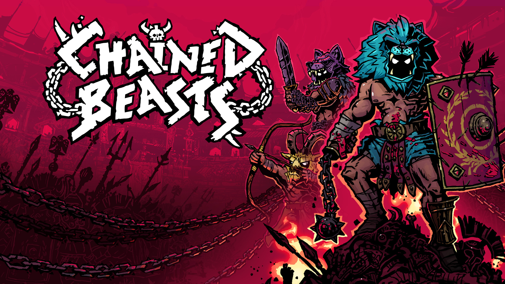
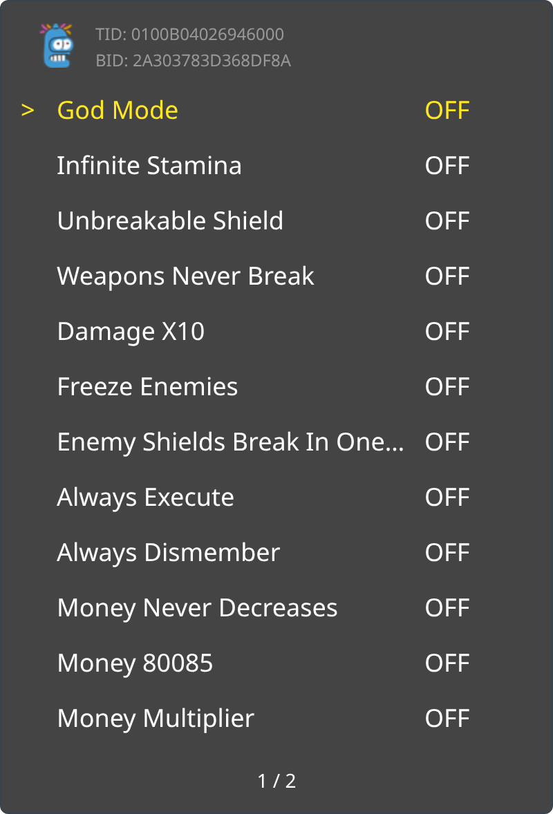
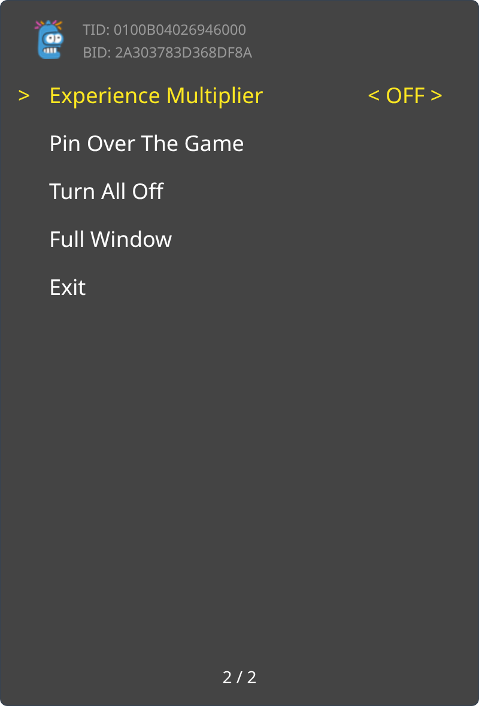

<p align="center">
  
</p>

Chained Beasts is a 1-4 player co-op gladiator roguelike. Fight chaotic battles chained to your friends. Use your chains or the arena to beat up foes in creative ways and survive the day.

<p><a href="_assets/trainer-2A303783D368DF8A-main.png"></a> <a href="_assets/trainer-2A303783D368DF8A-page2.png"></a></p>

```graphql
# Chained Beasts (GLOBAL) (v196608)
./khuong/0100B04026946000/2A303783D368DF8A/*
  ├─ God Mode
  ├─ Infinite Stamina
  ├─ Unbreakable Shield
  ├─ Weapons Never Break
  ├─ Damage x10
  ├─ Freeze Enemies
  ├─ Enemy Shields Break In One Hit
  ├─ Always Execute
  ├─ Always Dismember
  ├─ Money Never Decreases
  ├─ Money 80085
  ├─ Money Multiplier/*
  │  ├─ Money Multiplier (2x)
  │  ├─ Money Multiplier (4x)
  │  └─ Money Multiplier (8x)
  └─ Experience Multiplier/*
     ├─ Experience Multiplier (2x)
     ├─ Experience Multiplier (5x)
     └─ Experience Multiplier (10x)
```

## Changelog
[View here](./CHANGELOG.md)

## Support

Everything here is free and stays free. If you want to leave a tip anyway:
[ko-fi.com/bad1dea](https://ko-fi.com/bad1dea).
