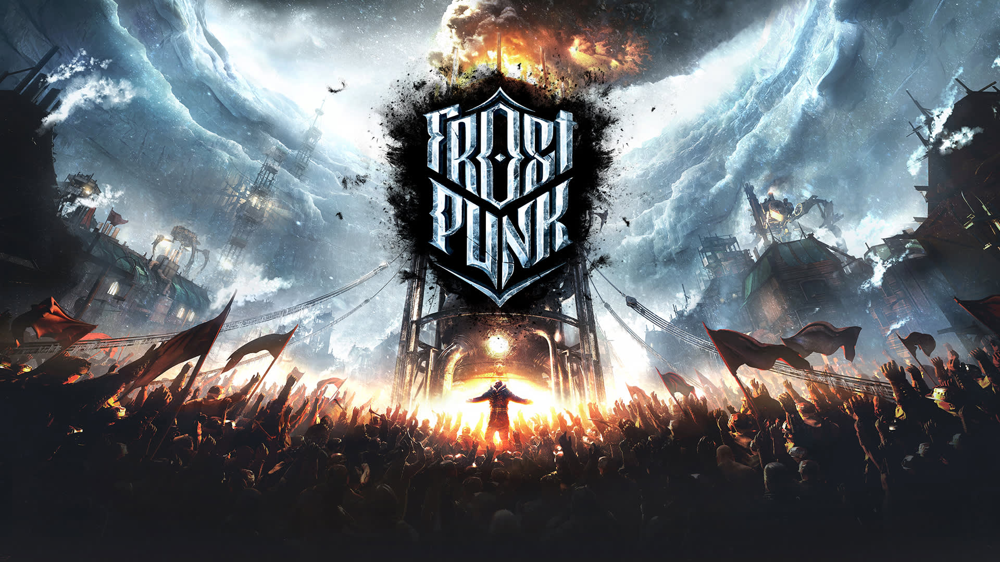
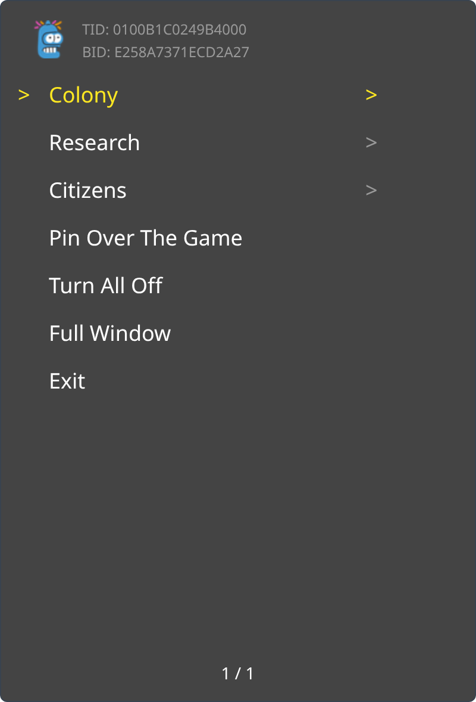
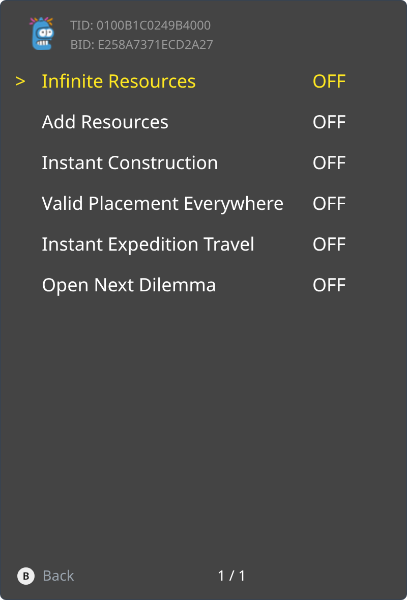

<p align="center">
  
</p>

Frostpunk is a society survival game where heat means life and every decision comes at a price. In an entirely frozen world, people develop steam-powered technology to oppose the overwhelming cold.

<p><a href="_assets/trainer-E258A7371ECD2A27-main.png"></a> <a href="_assets/trainer-E258A7371ECD2A27-folder.png"></a></p>

```graphql
# Frostpunk (GLOBAL) (v65536)
./khuong/0100B1C0249B4000/E258A7371ECD2A27/*
  ├─ Colony/*
  │  ├─ Infinite Resources (Stays Until Restart)
  │  ├─ Add Resources
  │  ├─ Instant Construction
  │  ├─ Valid Placement Everywhere
  │  ├─ Instant Expedition Travel
  │  └─ Open Next Dilemma
  ├─ Research/*
  │  ├─ Instant Research
  │  ├─ Research All Technologies
  │  ├─ Unlock All Technologies
  │  ├─ Unlock All Buildings
  │  ├─ Unlock All Sociotech
  │  └─ Reset Sociotech Cooldown
  └─ Citizens/*
     ├─ Immortal Citizens
     ├─ Freeze Citizen Statistics
     ├─ No Critical Citizen Levels
     ├─ Max Hope
     ├─ No Discontent
     └─ Freeze Alignments
```

## Changelog
[View here](./CHANGELOG.md)

## Support

Everything here is free and stays free. If you want to leave a tip anyway:
[ko-fi.com/bad1dea](https://ko-fi.com/bad1dea).
