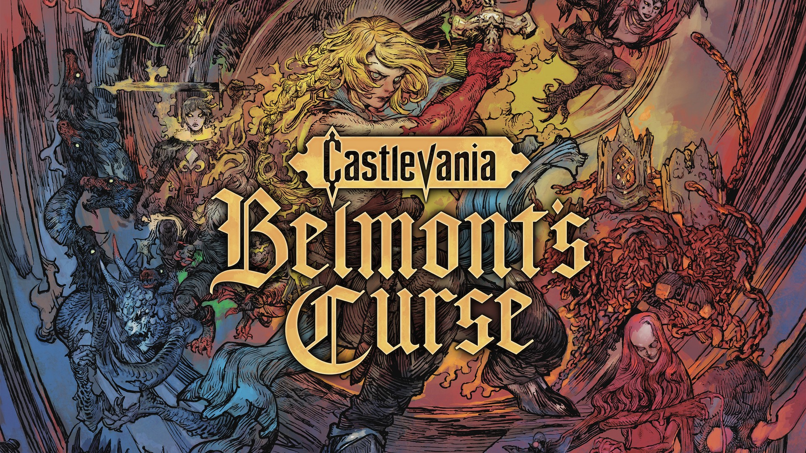
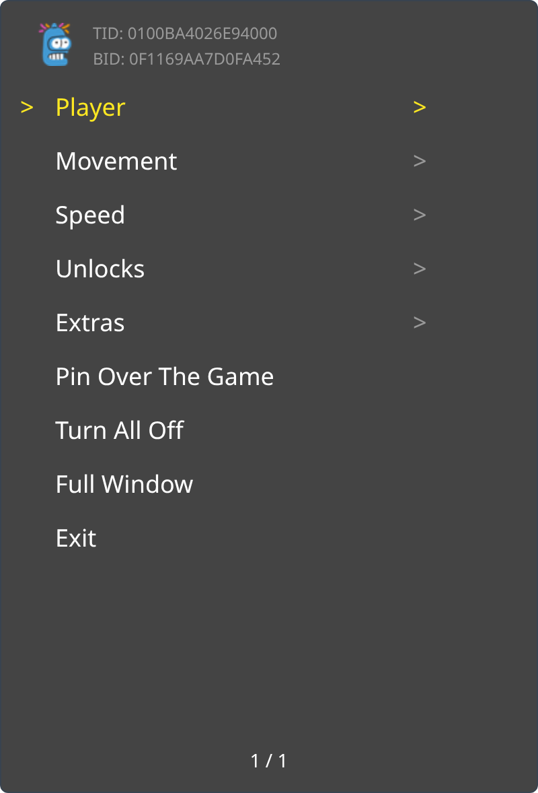
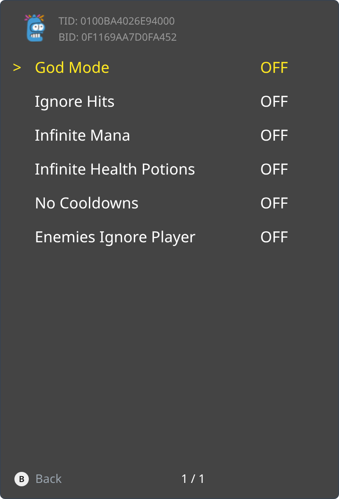
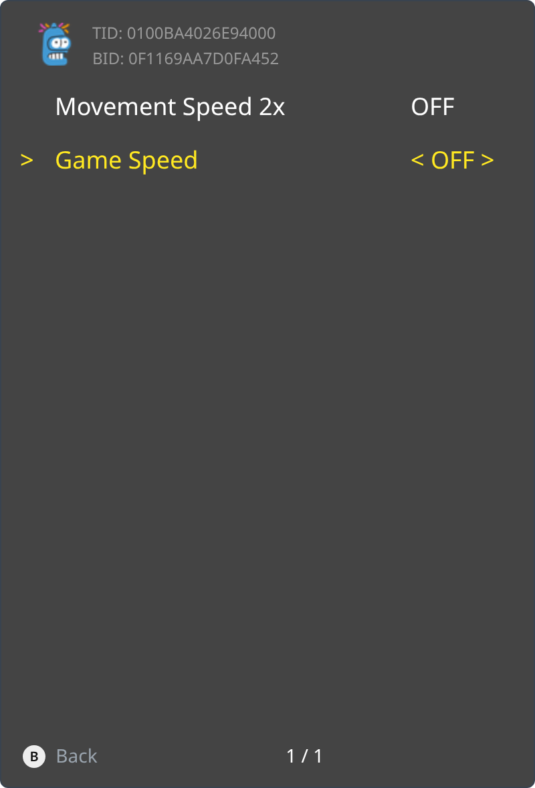

<p align="center">
  
</p>

Crimson Curse - Will Your Fate Bloom in Despair or Salvation

Debug Hotkeys: hold L and R, then press Left for Boost Stats (+10 levels), Right for Level Up, Down for Unlock Next Ability, A for Refill Life or B for Refill Mana.

<p><a href="_assets/trainer-0F1169AA7D0FA452-main.png"></a> <a href="_assets/trainer-0F1169AA7D0FA452-folder.png"></a> <a href="_assets/trainer-0F1169AA7D0FA452-options.png"></a></p>

```graphql
# Castlevania: Belmont's Curse (GLOBAL) (v65536)
./khuong/0100BA4026E94000/0F1169AA7D0FA452/*
  ├─ Player/*
  │  ├─ God Mode
  │  ├─ Ignore Hits
  │  ├─ Infinite Mana
  │  ├─ Infinite Health Potions
  │  ├─ No Cooldowns
  │  └─ Enemies Ignore Player
  ├─ Movement/*
  │  ├─ Infinite Air Jumps
  │  ├─ Infinite Air Dashes
  │  ├─ No Fall Damage
  │  └─ No Fall Teleport
  ├─ Speed/*
  │  ├─ Movement Speed 2x
  │  └─ Game Speed/*
  │     ├─ Game Speed 0.5x
  │     ├─ Game Speed 1.5x
  │     └─ Game Speed 2x
  ├─ Unlocks/*
  │  ├─ Unlock All Abilities
  │  ├─ Unlock All Maps
  │  ├─ Reveal Fog of War
  │  ├─ Unlock All Fast Travel
  │  └─ Easy Arcana Tasks
  └─ Extras/*
     ├─ Skip Cutscenes
     ├─ Skip Videos
     └─ Debug Hotkeys (L+R + D-pad, A or B)
```

## Changelog
[View here](./CHANGELOG.md)

## Support

Everything here is free and stays free. If you want to leave a tip anyway:
[ko-fi.com/bad1dea](https://ko-fi.com/bad1dea).
