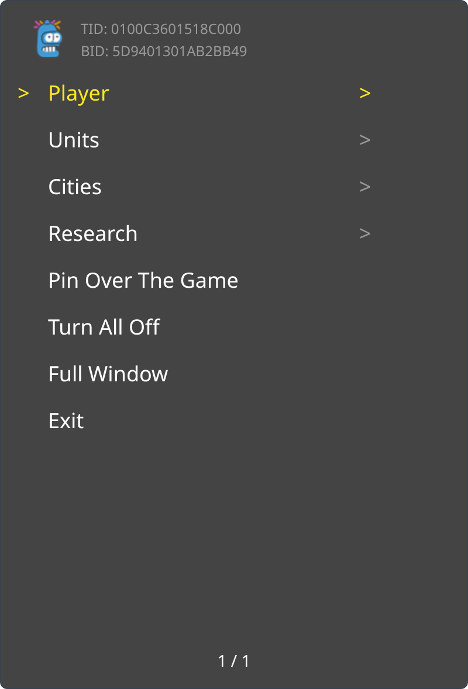
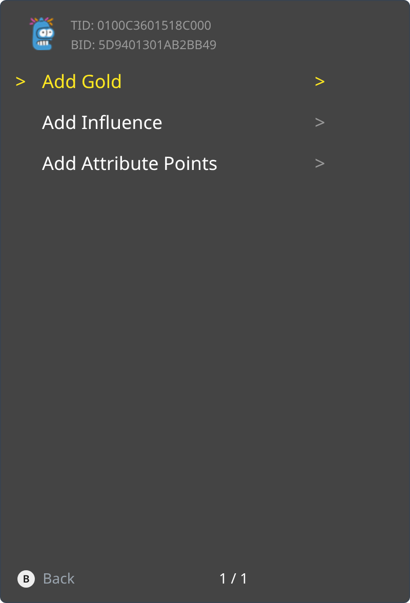

<p align="center">
  
</p>

Build Something You Believe In

<p><a href="_assets/trainer-5D9401301AB2BB49-main.png"></a> <a href="_assets/trainer-5D9401301AB2BB49-folder.png"></a></p>

```graphql
# Sid Meier's Civilization® VII (GLOBAL) (1.5.0.1)
./khuong/0100C3601518C000/5D9401301AB2BB49/*
  ├─ Add Gold 10K
  ├─ Add Gold 100K
  ├─ Add Gold 1M
  ├─ Add Influence 100
  ├─ Add Influence 500
  ├─ Add Influence 1K
  ├─ Add Influence 5K
  ├─ Add Influence 10K
  ├─ Add Attribute Points 1
  ├─ Add Attribute Points 5
  ├─ Add Attribute Points 10
  ├─ Add Attribute Points 25
  ├─ Add Attribute Points 50
  ├─ Restore Movement (Selected Unit)
  ├─ Heal (Selected Unit)
  ├─ Give Experience 20 (Selected Unit)
  ├─ Give Experience 50 (Selected Unit)
  ├─ Give Experience 100 (Selected Unit)
  ├─ Give Experience 200 (Selected Unit)
  ├─ Give Experience 500 (Selected Unit)
  ├─ Restore Movement (All Units)
  ├─ Heal (All Units)
  ├─ Complete Production (Selected City)
  ├─ Add Population 1 (Selected City)
  ├─ Add Population 2 (Selected City)
  ├─ Add Population 5 (Selected City)
  ├─ Add Population 10 (Selected City)
  ├─ Add Population 20 (Selected City)
  ├─ Complete Production (All Cities)
  ├─ Add Population 1 (All Cities)
  ├─ Add Population 2 (All Cities)
  ├─ Add Population 5 (All Cities)
  ├─ Add Population 10 (All Cities)
  ├─ Add Population 20 (All Cities)
  ├─ Complete Current Research
  ├─ Complete Current Civic
  ├─ Add Science 100
  ├─ Add Science 500
  ├─ Add Science 1K
  ├─ Add Science 5K
  ├─ Add Science 10K
  ├─ Add Culture 100
  ├─ Add Culture 500
  ├─ Add Culture 1K
  ├─ Add Culture 5K
  └─ Add Culture 10K
```

## Changelog
[View here](./CHANGELOG.md)

## Support

Everything here is free and stays free. If you want to leave a tip anyway:
[ko-fi.com/bad1dea](https://ko-fi.com/bad1dea).
